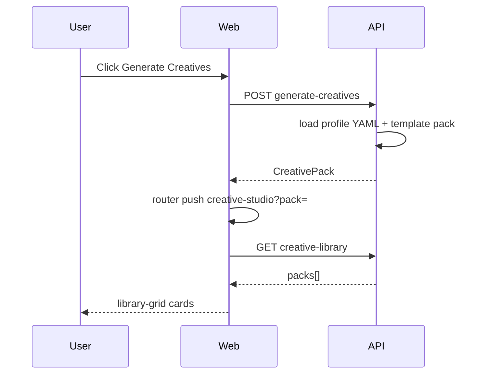

# Stage 4.5.2 — AI Creative Studio Architecture

**Status:** Complete (local QA profile `452`)  
**API version:** `0.5.2`  
**Provider policy:** **Zero paid AI providers** — generation uses in-process templates keyed off the owner’s YAML business profile.

---

## Goals

1. Close UX and test gaps from Creative Studio `0.5.2` without a rebuild.
2. Keep Community Edition safety: SYNTHETIC labeling, draft-only positioning, no external inference APIs.
3. Provide a repeatable QA stack: `.cga-qa-452` + API + web + Playwright E2E.

---

## Runtime topology

```text
.cga-qa-452 (ports, profile path, campaign id)
        │
        ├─► apps/api (FastAPI 0.5.2) ──► local template engine (creative.py)
        │
        └─► apps/web (Vite + React)
                ├─ Dashboard → Campaign
                ├─ Campaign → Generate Creatives (single <button>)
                └─ Handoff → AI Creative Studio library grid
```

| Service | Host / port | Health |
|---------|-------------|--------|
| API | `127.0.0.1:8452` | `GET /health` → `version: 0.5.2`, `provider_mode: local_template` |
| Web | `127.0.0.1:3452` | Vite dev or `dist/` preview |

---

## API surface (v0.5.2)

| Method | Path | Purpose |
|--------|------|---------|
| `GET` | `/health` | Version + provider mode |
| `GET` | `/api/v0.5.2/campaigns/{id}` | SYNTHETIC campaign metadata |
| `POST` | `/api/v0.5.2/campaigns/generate-creatives` | Build a creative pack (local templates) |
| `GET` | `/api/v0.5.2/creative-library` | List packs (optional `campaign_id` filter) |
| `GET` | `/api/v0.5.2/creative-packs/{pack_id}` | Fetch one pack |

**Generation contract:** `CreativePack` always sets `synthetic: true` and `provider: local_template`. Asset text may incorporate `business.name` from `config/examples/saas-b2b.synthetic.yaml` when present — never invented live metrics.

---

## Web information architecture

| Route | UI | Test IDs / a11y |
|-------|----|-----------------|
| `/` | Dashboard | `dashboard-open-campaign` |
| `/campaigns/:id` | Campaign creatives panel | `campaign-generate-creatives` (button), `campaign-creatives` (**always mounted**, empty or populated) |
| `/creative-studio` | AI Creative Studio library | `nav-ai-creative-studio`, `library-grid` (**visible**, grid layout; empty card when no packs) |

### Gap fixes (from 0.5.2 QA)

| Issue | Resolution |
|-------|------------|
| Nested `Link` + `Button` on Generate Creatives | Single native `<button type="button">` with `data-testid` |
| `campaign-creatives` only when assets exist | Section always rendered; empty state uses `campaign-creatives-empty` |
| `library-grid` hidden | Grid `display: grid` always; no conditional `hidden` |
| Selector / nav label mismatches | Nav label **AI Creative Studio** + matching `aria-label` and test id |

**Pack handoff:** successful generation navigates to `/creative-studio?pack=<uuid>&campaign=<id>` and highlights the pack card.

---

## Data flow (generate → library)



---

## Non-goals

- Paid image/copy APIs (OpenAI, Anthropic, Gemini, etc.)
- Auto-publish or auto-send
- Replacing Cursor workflow kit (`workflows/01–12`)

---

## References

- QA env: [`.cga-qa-452`](../.cga-qa-452)
- E2E: [`apps/web/scripts/_qa452_browser_e2e.mjs`](../apps/web/scripts/_qa452_browser_e2e.mjs)
- Screenshots: [`docs/screenshots/stage-4-5-2/`](./screenshots/stage-4-5-2/)