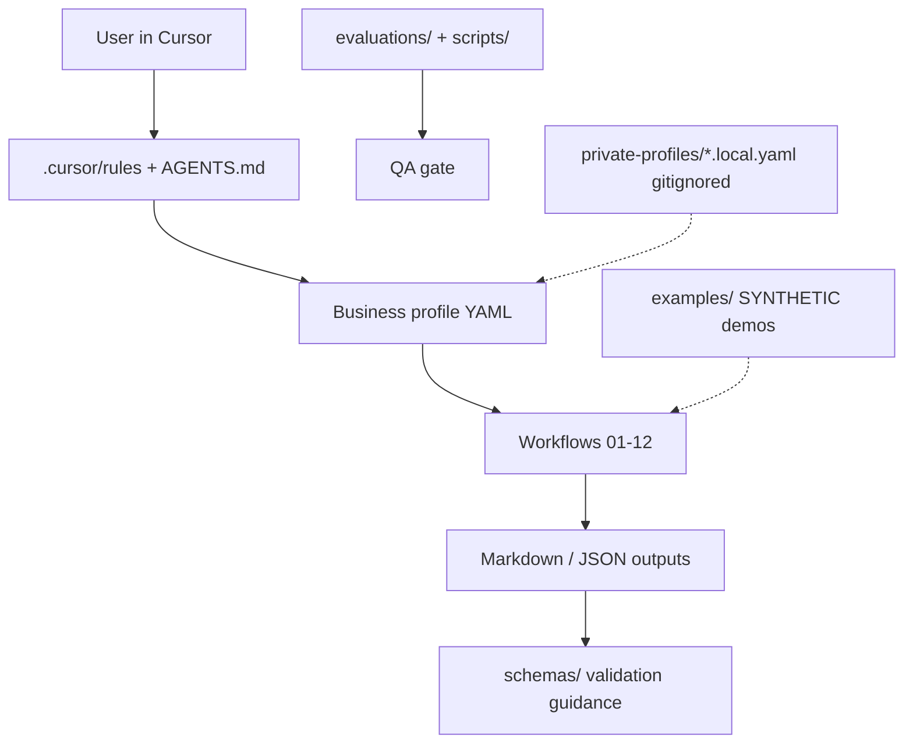

# Portfolio presentation pack (no live metrics)

**Do not invent stars, customers, usage numbers, or testimonials.**

## Suggested repository name

`creator-growth-agent`

## GitHub repository description

```text
A reusable AI-powered marketing and customer acquisition agent kit for Cursor. Research markets, qualify leads, validate demand, create personalized outreach, and measure growth.
```

## Suggested repository topics

`cursor` `ai-agent` `marketing-automation` `lead-generation` `customer-acquisition` `market-research` `growth-marketing` `prompt-engineering` `open-source`

## License badge line

```text
License: Apache-2.0
```

## README introduction (paste-ready)

```markdown
# Creator Growth Agent (Community Edition)

A **reusable Cursor-native AI marketing agent kit** — not an autonomous marketing platform and not a hosted SaaS.

Configure a business profile once, then run structured workflows for onboarding, research, ICP, prospecting, qualification, draft outreach (human approval required), discovery, positioning, campaigns, experiments, analytics, and growth recommendations.

**Requires:** Cursor (or compatible agent host) + an AI model. Research quality depends on the tools and sources you provide; the agent must not invent contacts or traction.
```

## Feature summary (honest)

- 12 markdown workflows with a standard evidence-based output format
- Central YAML business profile (optional fields; ask only blockers)
- Transparent lead scoring (0–100 with configurable weights)
- Draft-only personalized outreach with approval checklist
- JSON Schemas for structured artifacts
- Synthetic portfolio examples (clearly labeled)
- Automated QA evaluations (stdlib Python/shell)
- Private local profiles gitignored (e.g., Hub Clip owner config)
- Community vs Pro boundaries documented — no billing code in Community

## Architecture (Mermaid)



## Installation guide (short)

1. Copy kit to a clean repo (as root or subfolder).
2. `cp config/business-profile.example.yaml config/business-profile.yaml`
3. Open in Cursor; ensure the rule file loads.
4. Prompt: run workflow 01; do not invent facts.
5. `./scripts/run_evaluations.sh`

Details: [docs/QUICKSTART.md](../QUICKSTART.md).

## Example workflow (demo narrative)

1. Load SYNTHETIC SaaS profile with gaps → onboarding asks only blockers.
2. Refuse inventing 10 web prospects without sources → research plan instead.
3. Score five owner-provided leads with visible weights.
4. Draft three different outreach messages; approval required; no send.
5. Opt-out lead refused across channels.

Evidence: `evaluations/conversational/outputs/`.

## Screenshot / demo suggestions (record later)

1. Cursor chat running workflow 01 on an incomplete profile (show questions, not invented fields).
2. Lead score table with weights.
3. Outreach draft with APPROVAL REQUIRED block.
4. Terminal output of `./scripts/run_evaluations.sh` all green.
5. File tree of the kit at repo root.

Do not show private Hub Clip secrets. Prefer SYNTHETIC fixtures.

## LinkedIn / CV short description

```text
Built Creator Growth Agent (Community Edition): a Cursor-native marketing agent kit with 12 evidence-based workflows, YAML configuration, transparent lead scoring, draft-only outreach controls, schemas, and automated QA — designed as a portable open kit, not a hosted SaaS.
```

## What not to claim

- GitHub stars, download counts, or “used by N companies” without real data
- Autonomous sending, live CRM sync, or production cloud processing unless separately true
- Real customer testimonials from synthetic demos
